



---

### If you can verify it, you can solve it

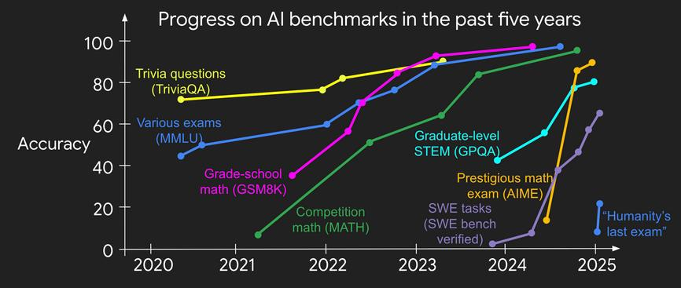

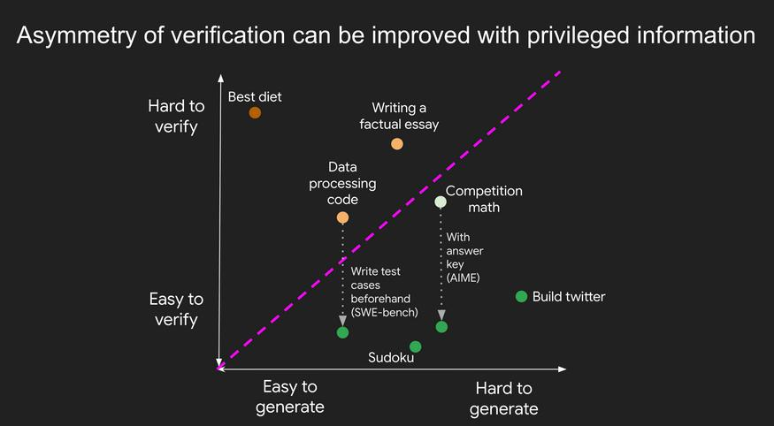

---

### The Clankers are here

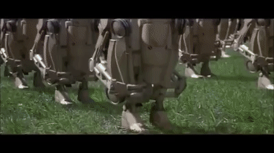

---

### It's all about the Harness

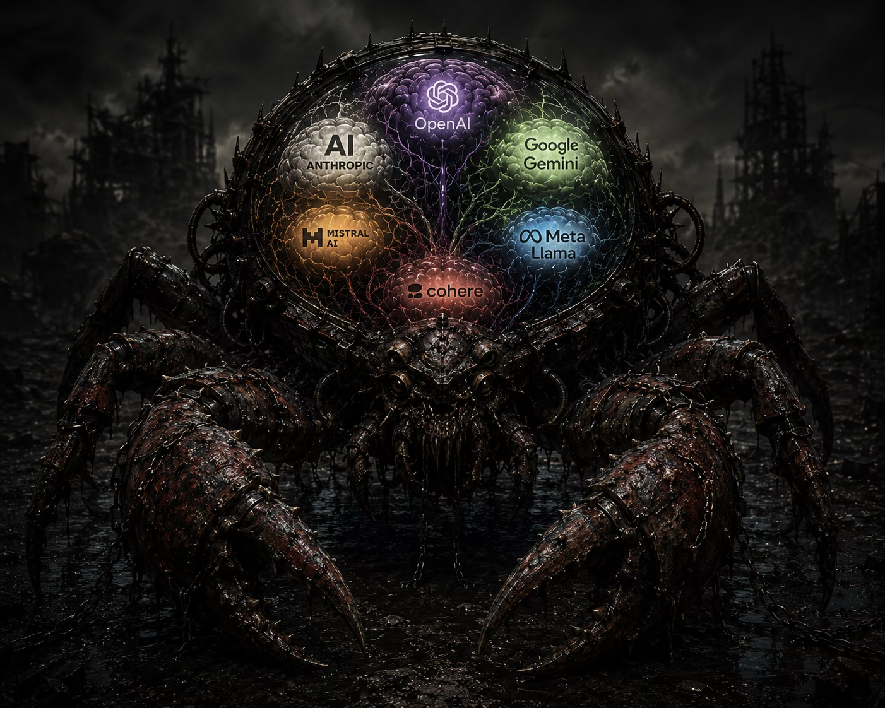

---

### Gyrokinetic simulations: turbulence follows field lines

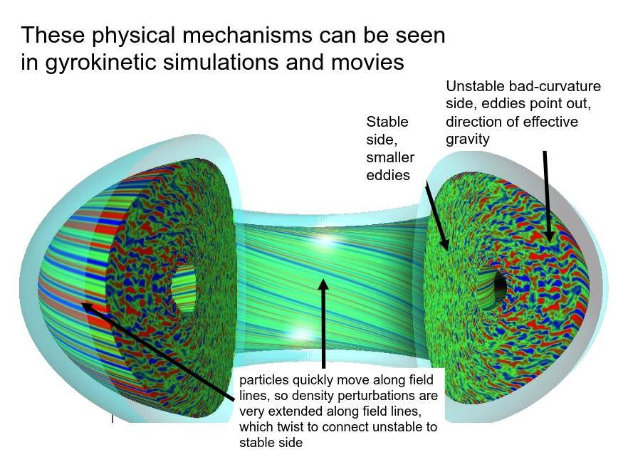

---

### What does the code simulate?

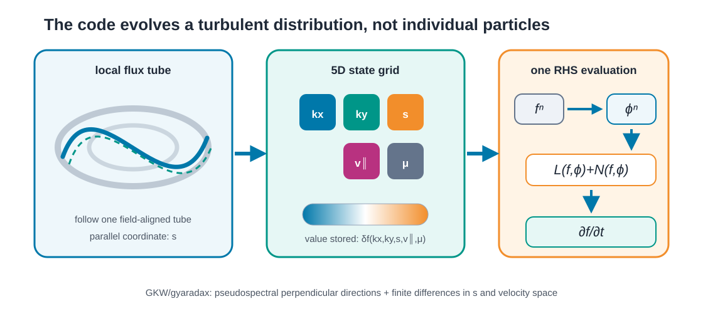

The unknown is a fluctuation field $\delta f(k_x,k_y,s,v_\parallel,\mu)$; the solver repeatedly computes fields $\phi$ and a right-hand side $\partial f/\partial t$.

---

### Gyrokinetic RHS: the terms the code evaluates

$$
\scriptsize
\begin{aligned}
    \frac{\partial f}{\partial t} ={}
    & \underbrace{\colorbox{#eee9ff}{$\displaystyle \vphantom{\frac{Z e F_M}{T}\left(v_\parallel\nabla_\parallel\bar{\phi}+i(\mathbf{k}_\perp\cdot\mathbf{v}_D)\bar{\phi}\right)} -v_\parallel\nabla_\parallel f$}}_{\text{Parallel Advection (I)}}
    \underbrace{\colorbox{#eee9ff}{$\displaystyle \vphantom{\frac{Z e F_M}{T}\left(v_\parallel\nabla_\parallel\bar{\phi}+i(\mathbf{k}_\perp\cdot\mathbf{v}_D)\bar{\phi}\right)} -i(\mathbf{k}_\perp\cdot\mathbf{v}_D)f$}}_{\text{Magnetic Drift (II)}}
    \underbrace{\colorbox{#eee9ff}{$\displaystyle \vphantom{\frac{Z e F_M}{T}\left(v_\parallel\nabla_\parallel\bar{\phi}+i(\mathbf{k}_\perp\cdot\mathbf{v}_D)\bar{\phi}\right)} +\mu\nabla_\parallel B\frac{\partial f}{\partial v_\parallel}$}}_{\text{Mirror Term (IV)}}
    \\
    & \underbrace{\colorbox{#e0f4f1}{$\displaystyle \vphantom{\frac{Z e F_M}{T}\left(v_\parallel\nabla_\parallel\bar{\phi}+i(\mathbf{k}_\perp\cdot\mathbf{v}_D)\bar{\phi}\right)} -\mathbf{v}_E\cdot\nabla F_M$}}_{\text{Equilibrium Drive (V)}}
    \underbrace{\colorbox{#e0f4f1}{$\displaystyle \vphantom{\frac{Z e F_M}{T}\left(v_\parallel\nabla_\parallel\bar{\phi}+i(\mathbf{k}_\perp\cdot\mathbf{v}_D)\bar{\phi}\right)} -\frac{Z e F_M}{T}\left(v_\parallel\nabla_\parallel\bar{\phi}+i(\mathbf{k}_\perp\cdot\mathbf{v}_D)\bar{\phi}\right)$}}_{\text{Field Drives (VII and VIII)}}
    \\
    & \underbrace{\colorbox{#ffe6e6}{$\displaystyle \vphantom{\frac{Z e F_M}{T}\left(v_\parallel\nabla_\parallel\bar{\phi}+i(\mathbf{k}_\perp\cdot\mathbf{v}_D)\bar{\phi}\right)} -\mathbf{v}_E\cdot\nabla_\perp f$}}_{\text{Nonlinear (III)}}
    \underbrace{\colorbox{#e8f1ff}{$\displaystyle \vphantom{\frac{Z e F_M}{T}\left(v_\parallel\nabla_\parallel\bar{\phi}+i(\mathbf{k}_\perp\cdot\mathbf{v}_D)\bar{\phi}\right)} -\mathcal{D}(f)$}}_{\text{Dissipation}}
\end{aligned}
$$

---

### The Fortran baseline: GKW

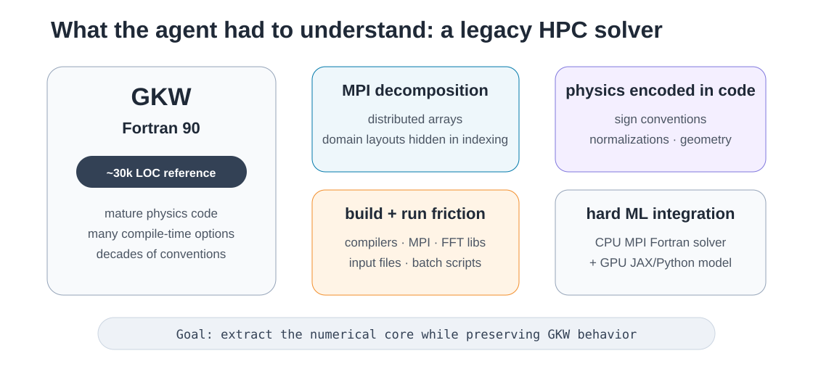

---

### Why this is not a normal ML port

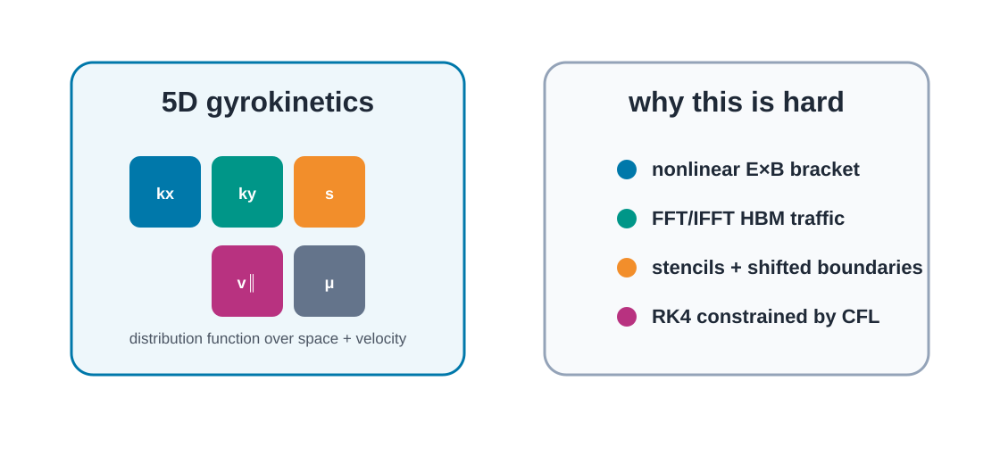

---

### From GKW to gyaradax

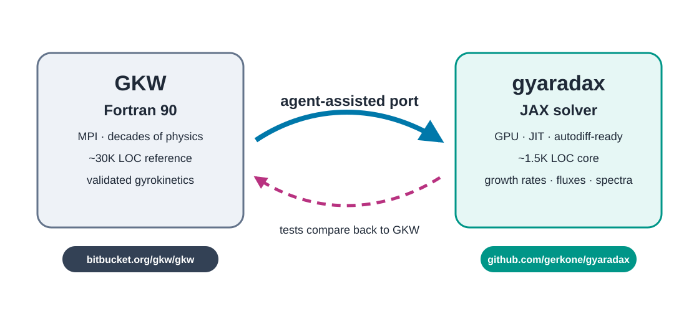

---

### Vibecoded CUDA kernels

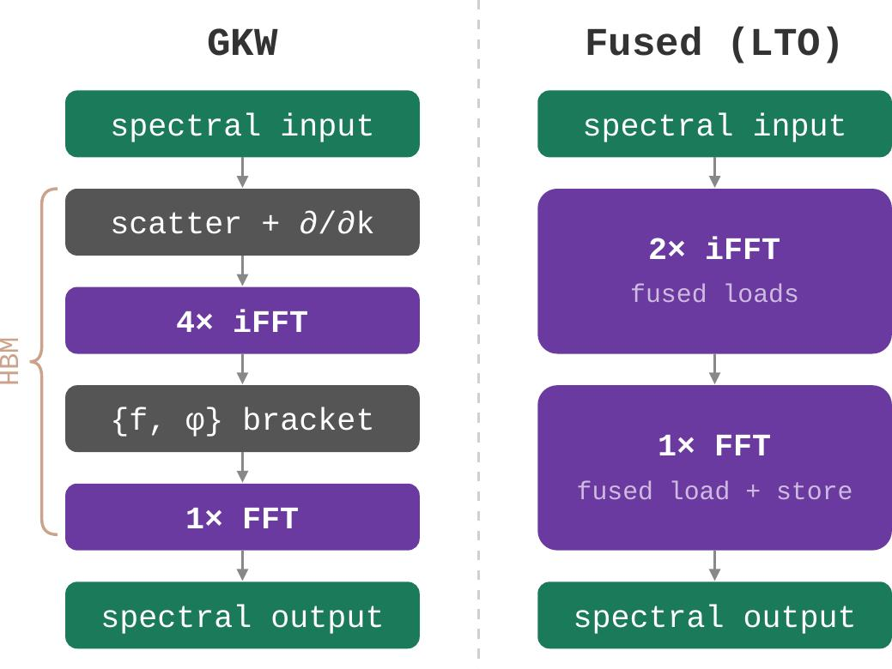

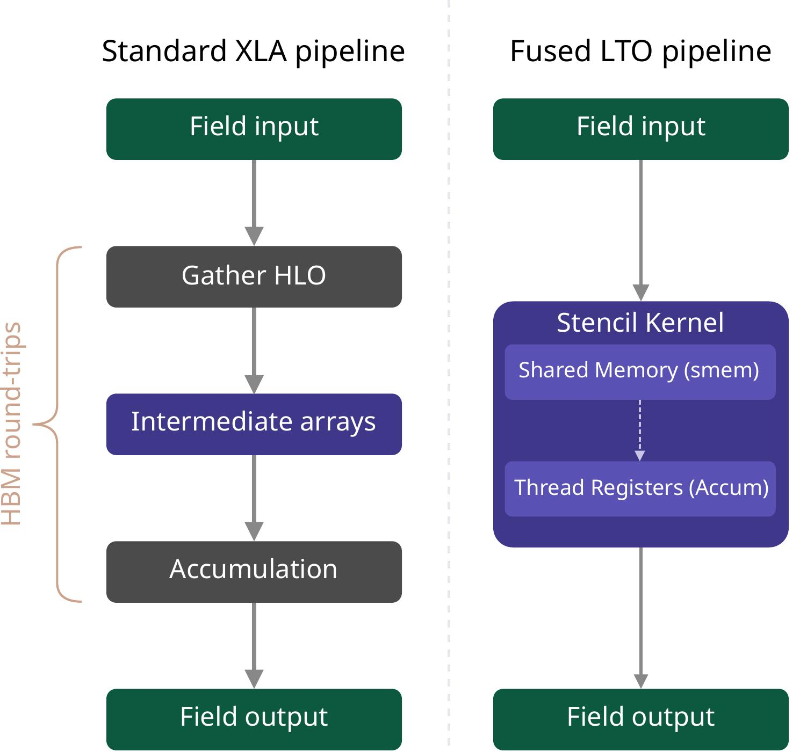

| Case                |   Best gyaradax config | Speedup vs GKW |
| ------------------- | ---------------------: | -------------: |
| Adiabatic electrons | CUDA + mixed precision |     **10.53×** |
| Kinetic electrons   | CUDA + mixed precision |      **8.21×** |

---

### Agent workflow: keep the harness in charge

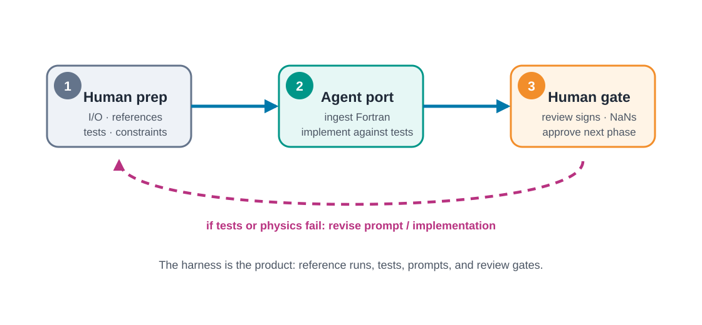

---

### Model lineup

| Model           | Role                       | Verdict                |
| --------------- | -------------------------- | ---------------------- |
| Gemini Pro      | first attempt              | killed before stage 3  |
| GPT CODEX       | F90 $\rightarrow$ JAX port | got linear terms right |
| Claude Opus     | kinetic electrons          | handled multi-species  |
| Gemini + Claude | refactor/docs              | polish, not physics    |

Agents translate well with a clear reference; they do not have physics intuition.

---

### Three-week speedrun

Agent speed is real — but only if the reference and tests are stronger than the agent.

---

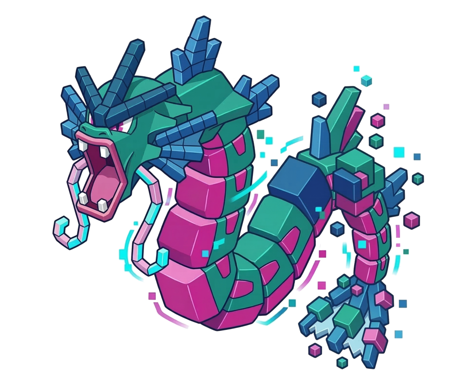

<a href="https://github.com/gerkone/gyaradax">github.com/gerkone/gyaradax</a> · ported from <a href="https://bitbucket.org/gkw/gkw">bitbucket.org/gkw/gkw</a>

---

### Current setup: pi as the harness

<b>One controlling agent</b>

- reads and edits the repo
- runs builds and tests
- regenerates figures
- keeps code and tests consistent

The LLM is not the workflow.

The harness is the workflow.

---

### Tools around the agent

| Tool                   | Why it matters                                     |
| ---------------------- | -------------------------------------------------- |
| linters / diagnostics  | catch syntax and type mistakes early               |
| tests / reference runs | prevent “looks plausible” physics bugs             |
| subagents              | parallel review, research, implementation attempts |
| code search / LSP      | jump through unfamiliar codebases                  |

Same idea as gyaradax: useful agents need a controlled environment, not just a chat box.

---

### Software engineering matters more, not less

As agents write more code, software design becomes the harness that keeps them useful.

- type systems
- API and system design
- testing and reference checks

- CI/CD pipelines
- reproducible environments
- clear interfaces between tools

