<style>
  .reveal section img {
    max-height: 450px !important;
    width: auto !important;
    object-fit: contain !important;
    margin: 20px auto !important;
    display: block !important;
  }
</style>





---

### Inverse Design: Topology Optimization

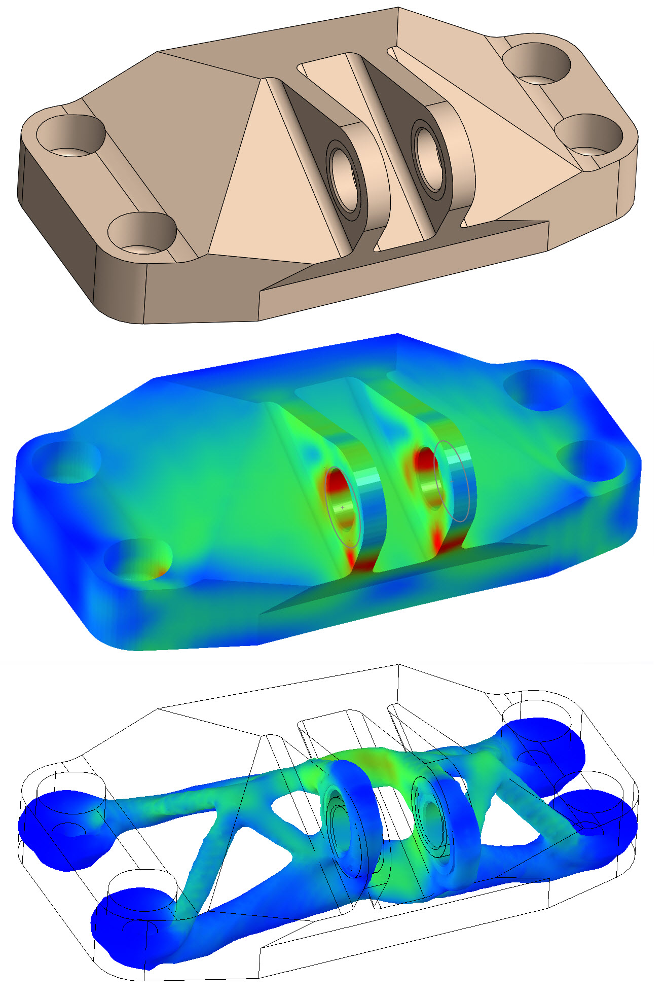

---

### Inverse Design: Geometry-informed NNs

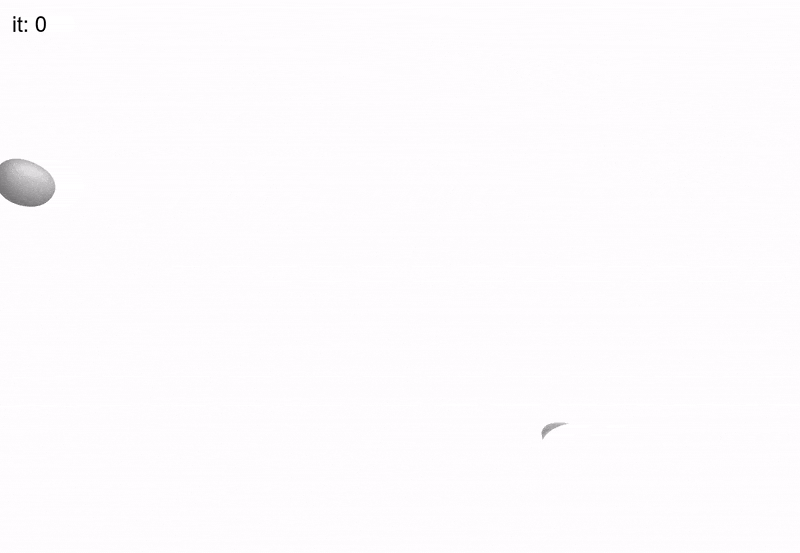

**But**: GINNs lacked physics - they are purely geometric.

---

### Background: Neural Implicit Shapes

<div style="display: flex; gap: 2rem; align-items: center;">

<div style="flex: 1; font-size: 0.75em;">

- A shape $S \subset \mathbb{R}^N$ is parameterized by an MLP $\phi_{\theta}$

- The NN defines a continuous scalar field $\phi_{\theta}: \mathbb{R}^N \rightarrow \mathbb{R}$

- $S$ is defined as level set: 

$S =  \left\{ x \in \mathbb{R}^N | \phi_{\theta}(x) \leq c \right\}$

$\partial S =  \left\{ x \in \mathbb{R}^N | \phi_{\theta}(x) = c \right\}$ 

</div>

<div style="flex: 1;">

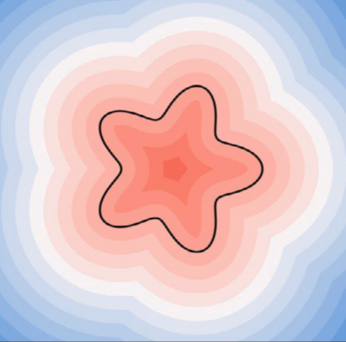

</div>

</div>

--- 

### Advantages and use cases

<div style="display: flex; gap: 2rem; align-items: center;">

<div style="flex: 0;">

- Resolution independent

- Intrinsic differentiability

- Parameter efficiency

</div>

<div style="flex: 0 0 auto;">


</div>

</div>

---

<style>
  /* Target the image directly by its name */
  img[alt="exploding mesh"] { 
    max-height: 400px !important; 
    width: auto !important; 
    object-fit: contain;
  }
</style>

### 1. Attempt: Add a FEM solver

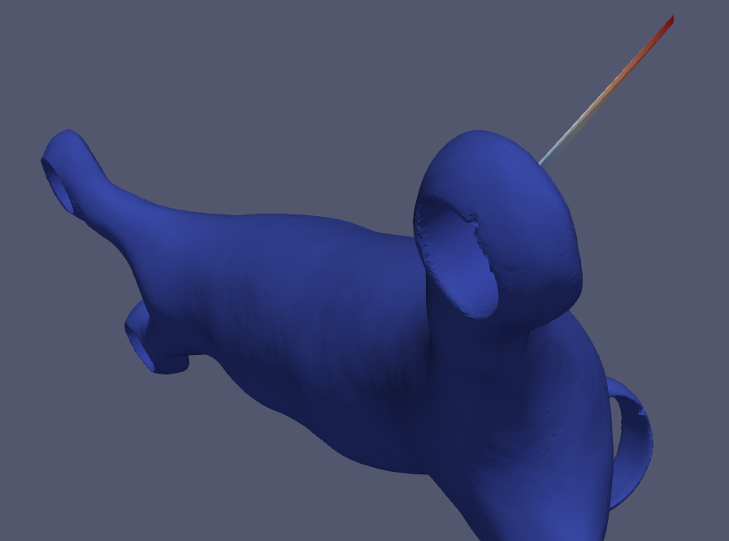

<div style="font-size: 0.7em">

Meshing can just randomly fail and the FEM solver can be unstable

</div>

---

### 2. Attempt: Monte Carlo PDE solvers

$$
\begin{align*}
\Delta u &= 0 \text{ in } \Omega \\
u &= g \text{ on } \partial \Omega
\end{align*}
$$

<div style="display: flex; gap: 2rem; align-items: flex-start;">

<div style="flex: 1; text-align: center;">

<div style="height: 350px; display: flex; align-items: center; justify-content: center;">

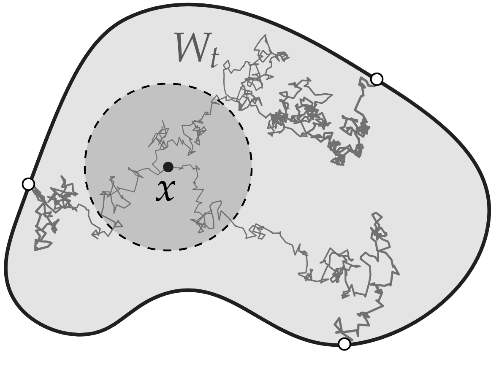

</div>

<div style="margin-top: 10px;">

<ins>Kakutani’s Principle</ins>

</div>

</div>

<div style="flex: 1; text-align: center;">

<div style="height: 350px; display: flex; align-items: center; justify-content: center;">

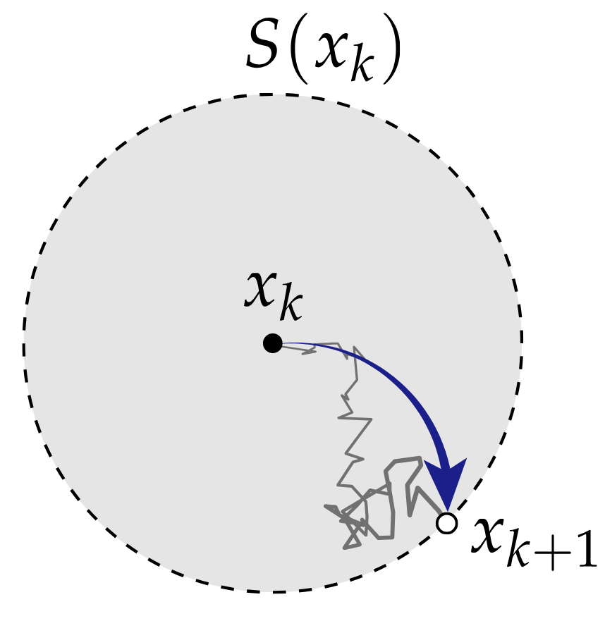

</div>

<div style="margin-top: 10px;">

<ins>Rotational symmetry</ins>

</div>

</div>

</div>

<style>
  img[alt="kakutani"], img[alt="empty jump"] {
    max-width: 100% !important;
    max-height: 100% !important; /* Scale to fit the wrapper div */
    width: auto !important;
    height: auto !important;
    object-fit: contain;
  }
</style>

---

### Basic Walk on Spheres

<div style="display: flex; flex-direction: column; align-items: center; gap: 2rem; width: 100%;">

<div style="width: 90%; text-align: left; font-size: 0.7em;">

```python
def WoS(x0, g, N, eps):
  u_hat = 0 # estimate of u(x0)
  for i in range(0, N):
    x = x0
    r = dist(x, boundary) # distance to boundary
    while  r > eps: # still in domain
      x = x + r * sample_unit_sphere() # uniform sample on sphere centred at x
      r = dist(x, boundary)
    u_hat += g(x)
  return u_hat / N 
```
</div>

<div style="height: 300px; display: flex; align-items: center; justify-content: center; width: 70%">


</div>

</div>

<style>
  img[alt="WoS scheme"] {
    max-width: 100% !important;
    max-height: 100% !important; /* Scale to fit the wrapper div */
    width: auto !important;
    height: auto !important;
    object-fit: contain;
  }
</style>

---

### Analogy: Rendering vs. PDE Solving

<div style="display: flex; gap: 2rem; align-items: flex-start;">

<div style="flex: 1; text-align: center;">

<div style="height: 350px; display: flex; align-items: center; justify-content: center;">

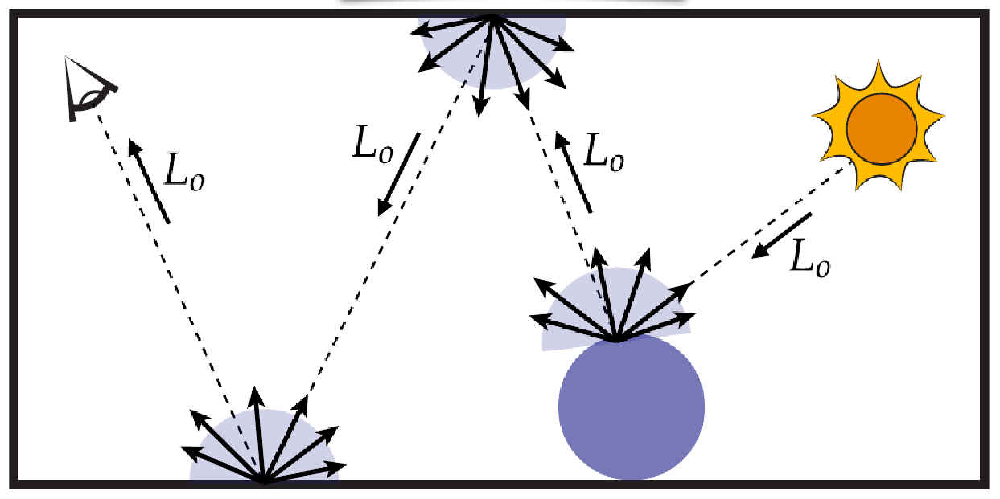

</div>

<div style="margin-top: 10px;">

Rendering Equation

Ray Tracing

<span style="background: rgba(1, 120, 170, 0.1); border: 1px solid #0078aa; padding: 2px 5px; border-radius: 6px; color: #0078aa; font-weight: bold;">Ray Intersection Queries</span>

</div>

</div>

<div style="flex: 1; text-align: center;">

<div style="height: 350px; display: flex; align-items: center; justify-content: center;">


</div>

<div style="margin-top: 10px;">

Elliptic PDEs

Random Walks

<span style="background: rgba(1, 120, 170, 0.1); border: 1px solid #0078aa; padding: 2px 10px; border-radius: 6px; color: #0078aa; font-weight: bold;">Closest Point Queries</span>

</div>

</div>

</div>

<style>
  img[alt="rendering scheme"], img[alt="WoS scheme"] {
    max-width: 100% !important;
    max-height: 100% !important; /* Scale to fit the wrapper div */
    width: auto !important;
    height: auto !important;
    object-fit: contain;
  }
</style>

---

### Problem

<div style="display: flex; align-items: center;">

<div style="flex: 1; font-size: 0.7em;">

- Neural fields are <ins>**not necessarily**</ins> exact signed distance functions.

- A usable Lipschitz bound $K$ is <ins>**not generally known or enforced**</ins>.

- Neural fields are <ins>**not necessarily**</ins> convex.

</div>

<div style="flex: 1">


</div>
</div>
$\longrightarrow$ How can we compute isosurface intersections of general neural fields?

---

### Majorizers/Minorizers for general MLPs

<div style="display: flex; align-items: center; gap: 2rem;">

<div style="flex: 1; min-width: 0; font-size: 0.6em;">

- Degree $k$ Taylor enclosure over trust region $[a,b]$

- Implemented as Taylor-mode automatic differentiation.

- Apply interval arithmetic to degree $k$ Taylor coefficients.
</div>

<div style="flex: 1.5; text-align: right;">

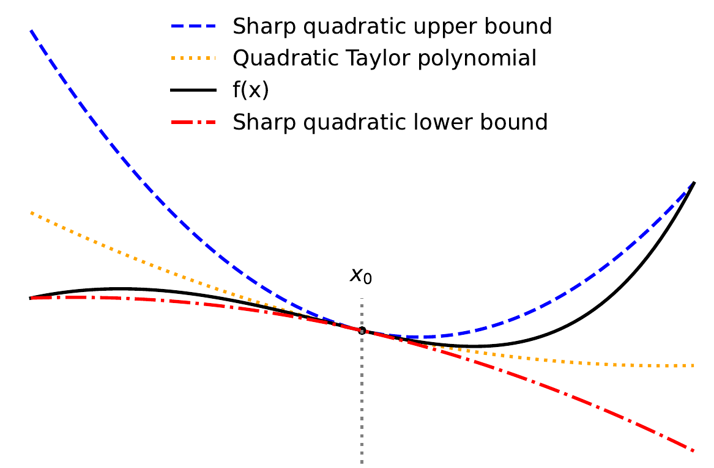

</div>
</div>

<style>
  /* Target the Taylor enclosure image for layout optimization */
  img[alt="taylor enclosure"] {
    max-width: 100% !important;
    height: auto !important;
    object-fit: contain;
    display: block;
    margin-left: auto;
  }
</style>

<div style="font-size: 0.6em;">
$$
\begin{align*}
F(x, x_0) =& \underbrace{\left( \sum_{i=0}^{k-1} \frac{1}{i!}f^{(i)}(x_0)(x - x_0)^i \right)}_{\text{degree } k -1 \text{ Taylor polynomial}} &+ \underbrace{I(x - x_0)^k}_{\text{Remainder bound}} 
\end{align*}
$$

</div>

---

### AutoBounded sphere tracing


---

### AutoBounded walk on spheres

<style>
  /* Strongly override global image limits specifically for this GIF */
  .reveal section img[alt="autobounded wos"] {
    max-height: 650px !important;
    width: auto !important;
    object-fit: contain !important;
    margin: 20px auto !important;
    display: block !important;
  }
</style>

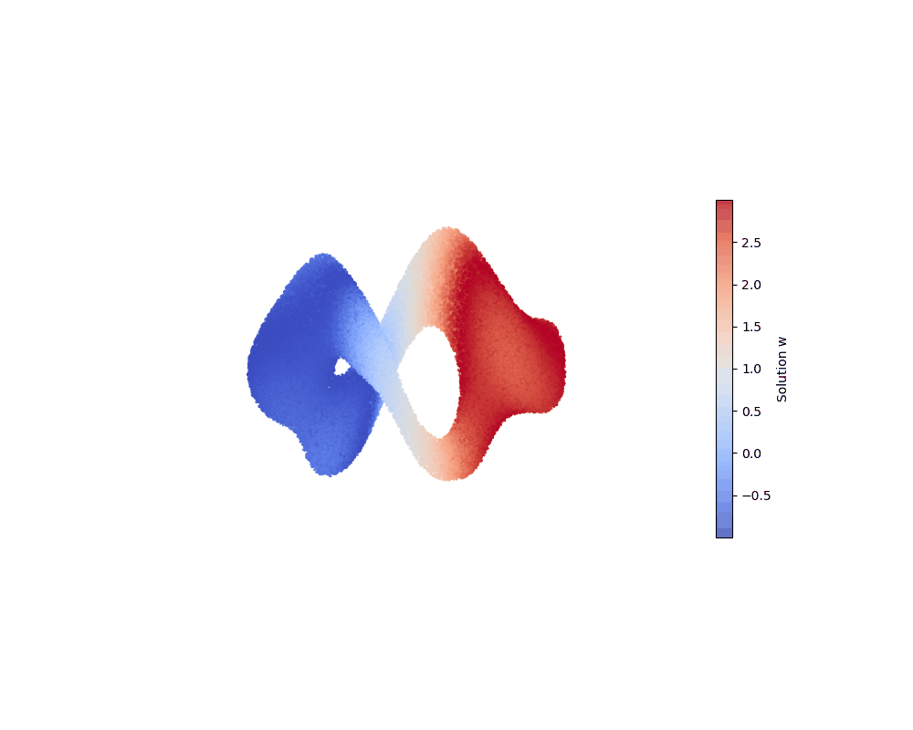

---

### AutoBounded surface point sampling

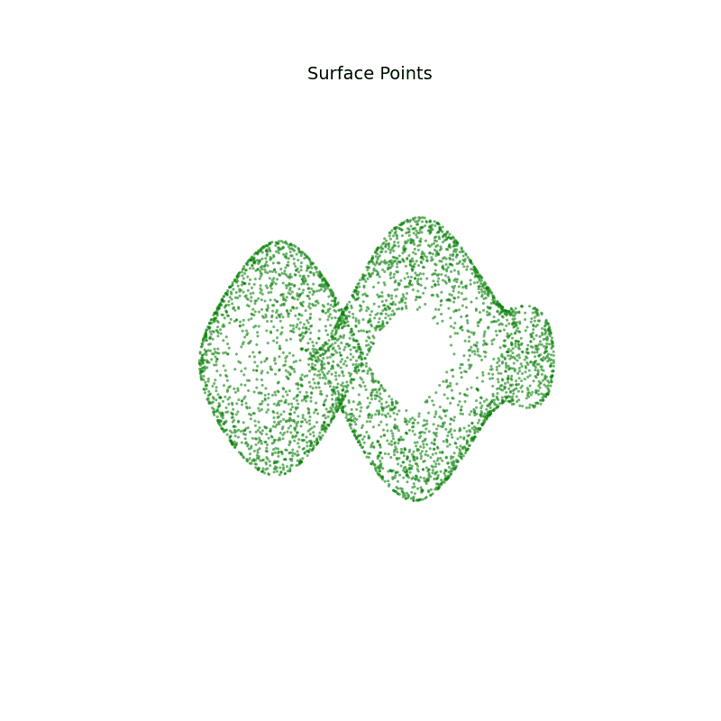

<style>
  /* Strongly override global image limits specifically for this GIF */
  .reveal section img[alt="autobounded surface sampling"] {
    max-height: 650px !important;
    width: auto !important;
    object-fit: contain !important;
    margin: 20px auto !important;
    display: block !important;
  }
</style>

---

### A lot of implementation work

- Rendering, point sampling and (differentiable) Monte Carlo Solver

- All are compatible with boundable implicits

- Performance (Array compaction, Wavefront Scheduling, ...)

- Fully fused Taylor enclosure kernels

    (Current: 15ms $\rightarrow$ 280$\mu$s)

---

### Validation on Analytical Solution

<style>
  /* Strongly force these images to be as large as possible */
  .reveal section div img[alt="surface integral grads"], 
  .reveal section div img[alt="domain integral grads"] {
    max-height: 620px !important;
    width: 100% !important;
    max-width: 100% !important;
    object-fit: contain !important;
    margin: 0 !important;
  }
</style>

<div style="display: flex; gap: 2rem; align-items: flex-start; justify-content: center;">

<div style="flex: 2; text-align: center;">

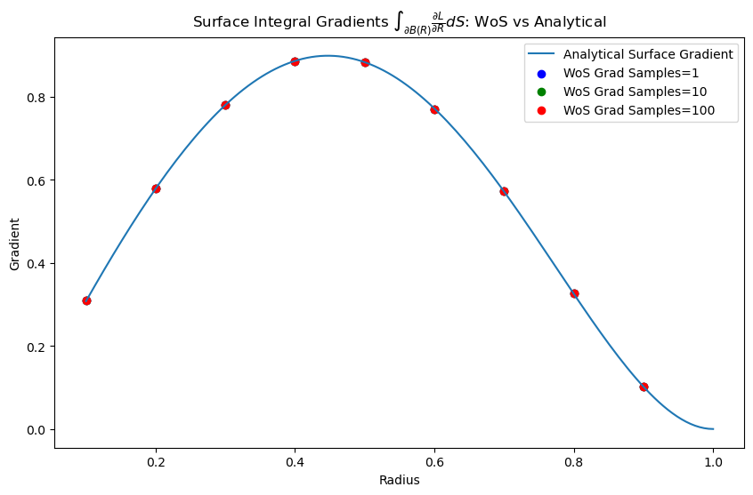

</div>

<div style="flex: 2; text-align: center;">

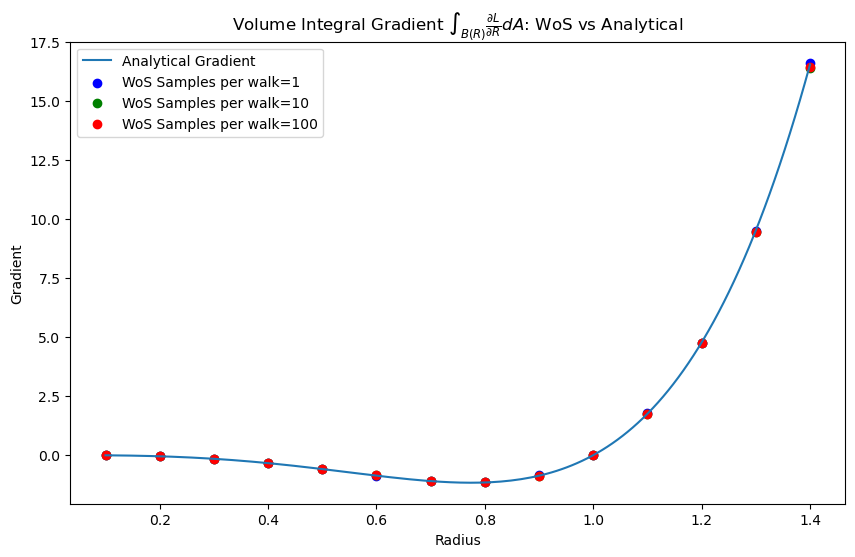

</div>

</div>

---

Questions?
