



---

### Background: Neural Implicit Shapes

<div style="display: flex; gap: 2rem; align-items: center;">

<div style="flex: 1; font-size: 0.75em;">

- A shape $S \subset \mathbb{R}^N$ is parameterized by an MLP $\phi_{\theta}$

- The neural network defines a continuous scalar field $\phi_{\theta}: \mathbb{R}^N \rightarrow \mathbb{R}$

- The geometry is implicitly defined as level set: 

$S =  \left\{ x \in \mathbb{R}^N | \phi_{\theta}(x) \leq c \right\}$

$\partial S =  \left\{ x \in \mathbb{R}^N | \phi_{\theta}(x) = c \right\}$ 

</div>

<div style="flex: 1;">


</div>

</div>

--- 

### Advantages and use cases

<div style="display: flex; gap: 2rem; align-items: center;">

<div style="flex: 0;">

- Resolution independent

- Intrinsic differentiability

- Parameter efficiency

</div>

<div style="flex: 0 0 auto;">

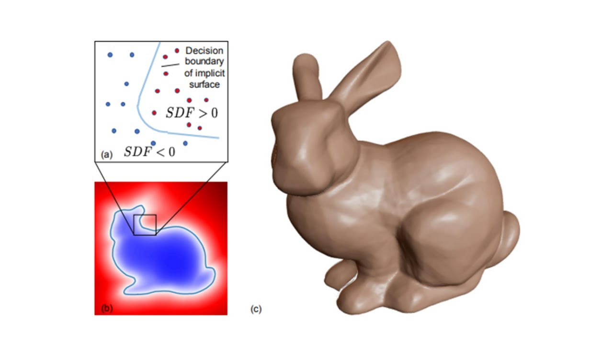

</div>

</div>


<!-- Note:
    queries at arbitrary precision
    fine detail capture -->
<!-- Note:
    Powerful modern tensor / autodifferentiation libraries (PyTorch, Jax)
    surface normals ( n = ∇ɸθ  ) 
    gradient based optimization -->
<!-- Note:
    compact representation of high fidelity geometries -->

---

### Training Flexibility

Can be trained from a wide variety of sources:

- Data: multiview images, point clouds, meshes, voxel grids, ...

- Differentiable simulations

- Geometric primitives

- PDE residuals

--- 

### Geometry-informed neural networks


- A neural field is trained on geometric inputs of the user

- Adding a latent input $z$ allows a neural field to encode multiple shapes: $F_{\theta}(x; z): z \rightarrow f_{\theta, z}(x) $

- An explicit diversity loss prevents mode collapse

---

### Geometry-informed neural networks

<div style="display: flex; gap: 2rem; align-items: center;">

<div style="flex: 1; height: 100%;">

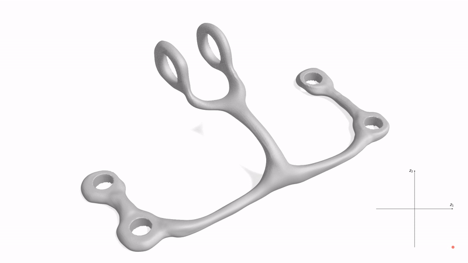

</div>

<div style="flex: 1; height: 100%;">

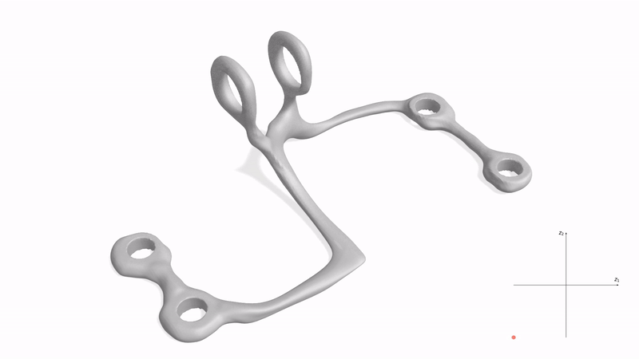 

</div>

</div>

**But:** No physics. Purely geometrical!

---

### 1. Attempt:  Add a FEM solver

.png)

Parametrize the density field $\rho_i$ with a (conditional) neural field

Train on FEM solver gradients and a diversity measure $\delta (\rho_i)$

---



<style>

/* This targets only images inside slides with the "small-svg" class */
.small-svg img {
  max-height: 350px !important;
  width: auto !important;
  background: transparent;
}

</style>

### 1. Attempt: Add a FEM solver

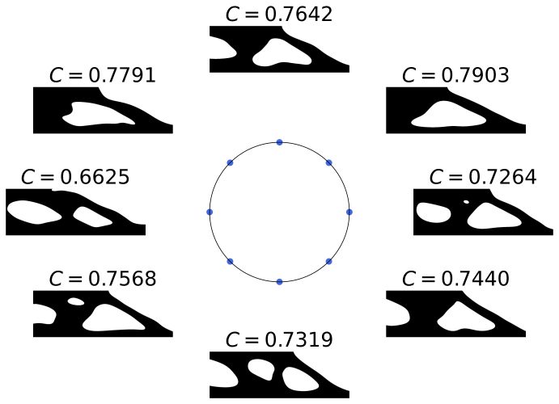 

Main Limitation: Applying FEM to a fixed, user defined mesh

---

<style>
  /* Target the image directly by its name */
  img[alt="exploding mesh"] { 
    max-height: 400px !important; 
    width: auto !important; 
    object-fit: contain;
  }
</style>

### 1. Attempt: Add a FEM solver


<div style="font-size: 0.7em">

Meshes extracted from neural fields with marching cubes can be invalid.

Meshing can become the bottleneck at high resolutions.

</div>

---

### Alternative? Monte Carlo PDE solvers

<div class="r-hstack">

<div>

**Solve**: Linear elliptic PDE

</div>

<div>
$$
\begin{align*}
\Delta u &= 0 \text{ in } \Omega \\
u &= g \text{ on } \partial \Omega
\end{align*}
$$
</div>

</div>

<div style="display: flex; gap: 2rem; align-items: center; width: 100%;">

<div style="flex: 1.5; min-width: 0;">

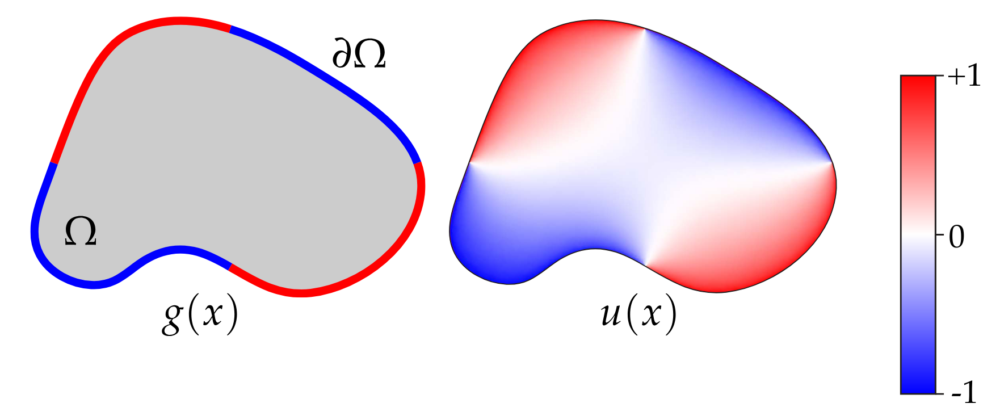

</div>

<div style="flex: 1; min-width: 0;">

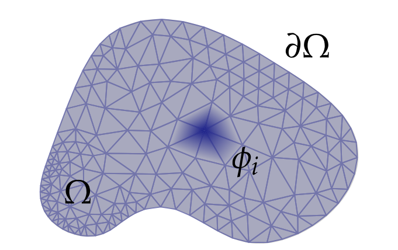

</div>

</div>

<style>
  img[alt="laplace 2d"], img[alt="meshing 2d"] {
    max-width: 100% !important;  /* Never exceed the column width */
    max-height: 500px !important; /* Never fall off the bottom */
    width: auto !important;       /* Maintain aspect ratio */
    height: auto !important;      /* Maintain aspect ratio */
  }
</style>


---

### Basic Walk on Spheres

<div style="display: flex; flex-wrap: wrap; gap: 1rem; width: 100%; justify-content: center;">

<div style="flex: 1 0 45%; min-width: 0; text-align: left; font-size: 0.7em;">

  <ins>Mean value property</ins>

  $u(x) = \frac{1}{|\partial B(x)|} \int_{\partial B(x)} u(y) dy$
  
</div>

<div style="flex: 1 0 45%; min-width: 0; text-align: left; font-size: 0.7em;">

  <ins>Kakutani’s Principle</ins>

  $u(x) = \mathbb{E} [g(W_T)] $

</div>

<div style="flex: 1 0 45%; min-width: 0; text-align: left; font-size: 0.7em;">

  <ins> Rotational symmetry </ins>

  $\mathbb{E}[u(W_T)] = \frac{1}{|\partial B(x)|} \int_{\partial B(x)} u(y) dy$

</div>


<div style="flex: 1 0 45%; min-width: 0; text-align: center; font-size: 0.7em;">

- $g$: Boundary condition

- $W_T$: Wiener Process hitting boundary at time $T$

</div>

</div>

---

### Basic Walk on Spheres

<div style="display: flex; gap: 2rem; align-items: flex-start;">

<div style="flex: 1; text-align: center;">

<div style="height: 350px; display: flex; align-items: center; justify-content: center;">


</div>

<div style="margin-top: 10px;">

<ins>Kakutani’s Principle</ins>

</div>

</div>

<div style="flex: 1; text-align: center;">

<div style="height: 350px; display: flex; align-items: center; justify-content: center;">


</div>

<div style="margin-top: 10px;">

<ins>Rotational symmetry</ins>

</div>

</div>

</div>

<style>
  img[alt="kakutani"], img[alt="empty jump"] {
    max-width: 100% !important;
    max-height: 100% !important; /* Scale to fit the wrapper div */
    width: auto !important;
    height: auto !important;
    object-fit: contain;
  }
</style>

---

### Basic Walk on Spheres

<div style="display: flex; flex-direction: column; align-items: center; gap: 2rem; width: 100%;">

<div style="width: 90%; text-align: left; font-size: 0.7em;">

```python
def WoS(x0, g, N, eps):
  u_hat = 0 # estimate of u(x0)
  for i in range(0, N):
    x = x0
    r = dist(x, boundary) # distance to boundary
    while  r > eps: # still in domain
      x = x + r * sample_unit_sphere() # uniform sample on sphere centred at x
      r = dist(x, boundary)
    u_hat += g(x)
  return u_hat / N 
```
</div>

<div style="height: 300px; display: flex; align-items: center; justify-content: center; width: 70%">

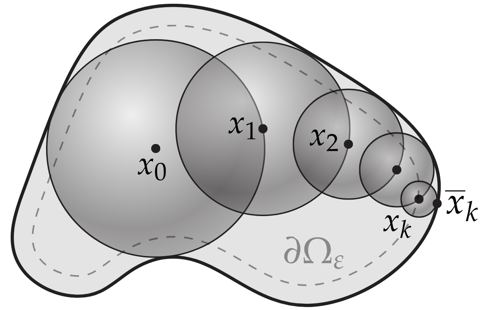

</div>

</div>

<style>
  img[alt="WoS scheme"] {
    max-width: 100% !important;
    max-height: 100% !important; /* Scale to fit the wrapper div */
    width: auto !important;
    height: auto !important;
    object-fit: contain;
  }
</style>

---

### Sphere Tracing

<div style="display: flex; flex-direction: column; align-items: center; gap: 2rem; width: 100%;">

<div style="width: 90%; text-align: left; font-size: 0.7em;">

```python
def sphere_trace(ro, rd, max_steps, eps):
  t = 0 # total distance traveled along ray
  for i in range(max_steps):
    p = ro + t * rd
    d = sdf(p) # signed distance to surface
    if d < eps: # hit the surface
      return t
    t += d # safely march forward
  return -1 # no intersection found
```
</div>

<div style="height: 300px; display: flex; align-items: center; justify-content: center; width: 70%">

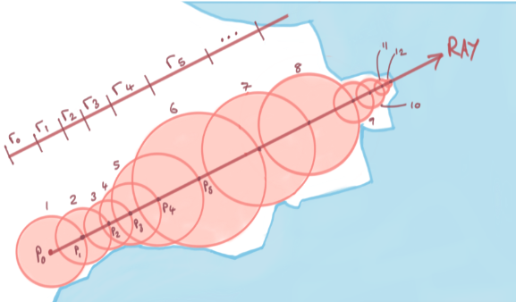

</div>

</div>

<style>
  img[alt="ST scheme"] {
    max-width: 100% !important;
    max-height: 100% !important; /* Scale to fit the wrapper div */
    width: auto !important;
    height: auto !important;
    object-fit: contain;
  }
</style>

---

### Analogy: Rendering vs. PDE Solving

<div style="display: flex; gap: 2rem; align-items: flex-start;">

<div style="flex: 1; text-align: center;">

<div style="height: 350px; display: flex; align-items: center; justify-content: center;">


</div>

<div style="margin-top: 10px;">

Rendering Equation

Ray Tracing

Ray Intersection Queries

</div>

</div>

<div style="flex: 1; text-align: center;">

<div style="height: 350px; display: flex; align-items: center; justify-content: center;">


</div>

<div style="margin-top: 10px;">

Elliptic PDEs

Random Walks

Closest Point Queries

</div>

</div>

</div>

<style>
  img[alt="rendering scheme"], img[alt="WoS scheme"] {
    max-width: 100% !important;
    max-height: 100% !important; /* Scale to fit the wrapper div */
    width: auto !important;
    height: auto !important;
    object-fit: contain;
  }
</style>

---

### Advantages

- <ins>**No**</ins> volumetric meshes

- Parallelizable

- Stochastic, pointwise estimates of $u$ and $\nabla u$ enough for SGD training

---

### Problem

<div style="display: flex; align-items: center;">

<div style="flex: 1; font-size: 0.7em;">

- Neural fields are <ins>**not necessarily**</ins> exact signed distance functions.

- A usable Lipschitz bound $K$ is <ins>**not generally known or enforced**</ins>.

- Neural fields are <ins>**not necessarily**</ins> convex.

</div>

<div style="flex: 1">

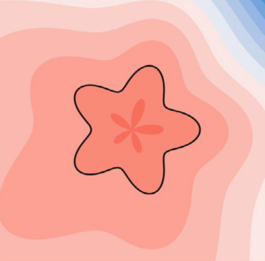

</div>
</div>
$\longrightarrow$ How can we compute isosurface intersections of general neural fields?

---

### 1 dimensional neural curve

<div style="display: flex; align-items: center; gap: 1rem;">

<div style="flex: 1; min-width: 0; font-size: 0.7em;">

- Root finding for a neural curve: solve $\phi(x)=0$.

- No manual parameter/step size tuning

- Line search / trust region adaptation too expensive

- Needs to converge from any starting point

</div>

<div style="flex: 1.5; min-width: 400px;">

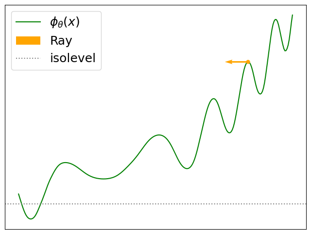

</div>
</div>

<style>
  img[alt="1d neural curve"] {
    max-width: 100% !important;
    height: auto !important;
    object-fit: contain;
  }
</style>

---

### Majorization-Minimization Algorithms

<div style="display: flex; align-items: center; gap: 1rem;">

<div style="flex: 1; min-width: 0; font-size: 0.7em;">

- **Definition:** $F$ majorizes $f$ if for any $y\in\mathbb{I}$:

  $f(x) \leq F(x, y) \forall x \in \mathbb{I}$
  
  $F(y, y) = f(y)$

- A candidate update is $x_{t+1} = \text{root}(F(x, x_t))$.

- Convergence requires additional assumptions and a valid root-selection rule.

</div>

<div style="flex: 1.5; min-width: 200px;">

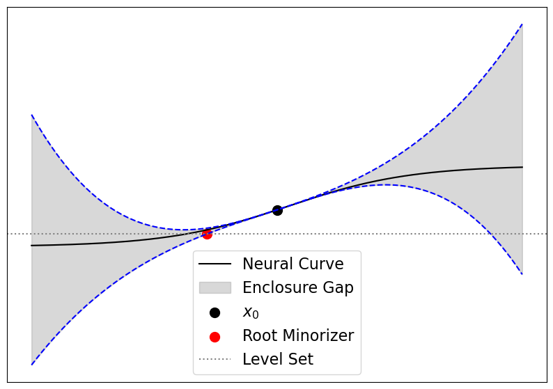

</div>
</div>

<style>
  /* 1. Target the correct Alt Text */
  img[alt="min max"] {
    /* 2. Standard aspect ratio fix */
    max-width: 100% !important;
    height: auto !important;
    object-fit: contain;
  }
</style>

---

### Majorizers/Minorizers for general MLPs

<div style="display: flex; align-items: center; gap: 1rem;">

<div style="flex: 1.2; min-width: 0; font-size: 0.5em;">

- AutoBounds - compute degree $k$ Taylor enclosure over trust region $[a,b]$

$$
\begin{align*}
F(x, x_0) =& \underbrace{\left( \sum_{i=0}^{k-1} \frac{1}{i!}f^{(i)}(x_0)(x - x_0)^i \right)}_{\text{degree } k -1 \text{ Taylor polynomial}}\\ &+ \underbrace{I(x - x_0)^k}_{\text{Remainder bound}} 
\end{align*}
$$

- Can be implemented as single (modified) forward pass

</div>

<div style="flex: 1; min-width: 200px;">


</div>
</div>

<style>
  /* 1. Target the correct Alt Text */
  img[alt="taylor enclosure"] {
    /* 2. Standard aspect ratio fix */
    max-width: 100% !important;
    height: auto !important;
    object-fit: contain;
  }
</style>

--- 

### AutoBounded sphere tracing

<div style="display: flex; align-items: center; gap: 1rem;">

<div style="flex: 1.3; min-width: 0; font-size: 0.7em;">

$$
\begin{aligned}
&\textbf{1. Compute root } x^* \text{ of bounding poly in } [x_t \pm L] \\
&\textbf{2. Update } x_{t+1}: \\
&\quad \text{If } |x^* - x_t| \le L: \quad x_{t+1} \leftarrow x^* \\
&\quad \text{Else}: \quad x_{t+1} \leftarrow x_t \pm L \\
&\textbf{3. Adapt } L: \\
&\quad \text{If } |x_{t+1} - x_t| = L: \quad L \leftarrow 2L \\
&\quad \text{If } |x_{t+1} - x_t| < L/2: \quad L \leftarrow L/2
\end{aligned}
$$

</div>

<div style="flex: 1; min-width: 300px;">


</div>
</div>

<style>
  /* 1. Target the correct Alt Text */
  img[alt="gromit speedy"] {
    /* 2. Standard aspect ratio fix */
    max-width: 100% !important;
    height: auto !important;
    object-fit: contain;
  }
</style>

---

### AutoBounded sphere tracing

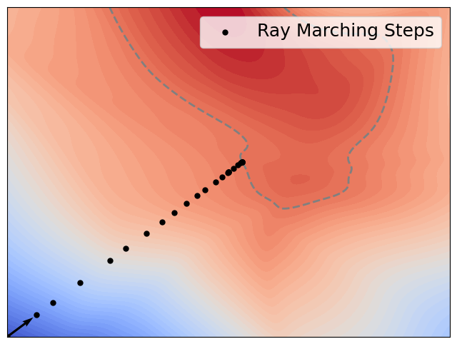

---

### Autobounded sphere tracing


---

### Autobounded surface point sampling

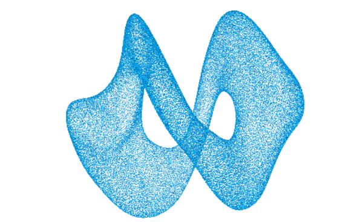

---

### Autobounded Walk on Spheres

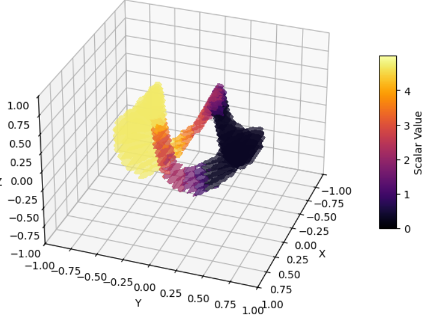

---

### Current problems: "Implementation details"

 -  AutoBound reference implementation has major issues, wasn't built for large vectorized queries 

 - Need to do rigorous experiments to measure performance wrt. size/width, activation function 

 - Use AutoBounds to map surface onto acceleration structures (surface mesh, octree) 

---

### References

<div style="font-size: 0.5em">

1. Berzins, A., Radler, A., Volkmann, E., Sanokowski, S., Hochreiter, S., & Brandstetter, J. Geometry-Informed Neural Networks. In Forty-second International Conference on Machine Learning.

2. Radler, A., Volkmann, E., Brandstetter, J., & Berzins, A. (2025). Generative topology optimization: exploring diverse solutions in structural design. arXiv preprint arXiv:2502.13174.

3. Hart, John C. "Sphere tracing: A geometric method for the antialiased ray tracing of implicit surfaces." The Visual Computer 12.10 (1996): 527-545.

4. Sawhney, Rohan, and Keenan Crane. "Monte Carlo geometry processing: A grid-free approach to PDE-based methods on volumetric domains." ACM Transactions on Graphics 39.4 (2020).

5. Streeter, Matthew, and Joshua V. Dillon. "Automatically bounding the taylor remainder series: Tighter bounds and new applications." arXiv preprint arXiv:2212.11429 (2022).

6. https://rohan-sawhney.github.io/mcgp-resources/

</div>

---

# Appendix

---

### Further ideas: Simulation on INRs

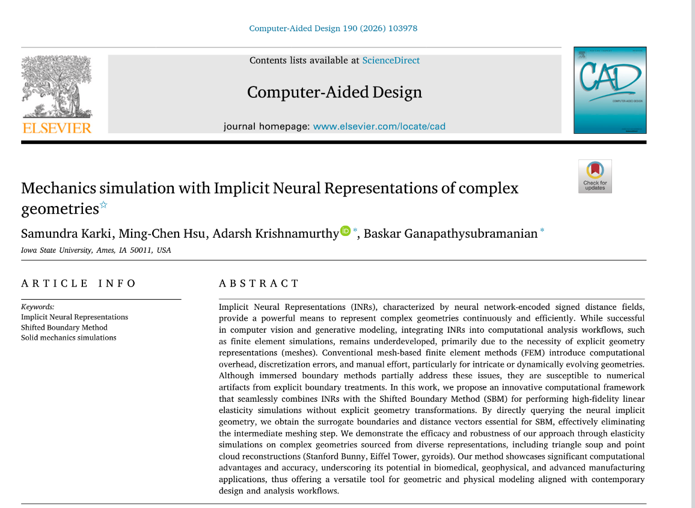

---

### Diffusion samplers for gradient free optimization

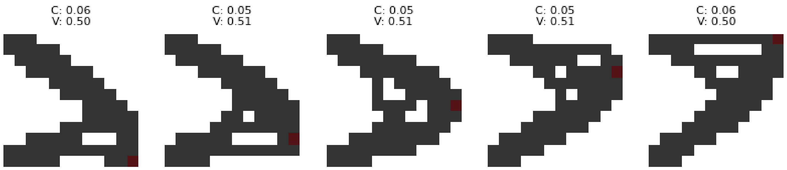
